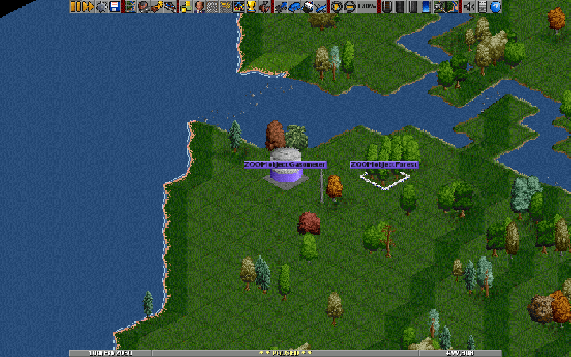

# OpenTTD — Smooth Zoom & Fly Navigation

An experimental [OpenTTD](https://github.com/OpenTTD/OpenTTD) fork with continuous
map zoom and animated camera journeys. This repository is the home of the fork;
the standard OpenTTD downloads do not include these changes.

**[Download the latest tested build](https://github.com/Deku-shrub/OpenTTD/releases/latest)** ?
**[Installation](docs/install_smooth_zoom.md)** ?
**[User guide](docs/smooth_zoom_readme.md)** ·
**[Animated examples](docs/smooth_zoom_readme.md#zoom-examples)** ·
**[Progress and TODO](docs/smooth_zoom_todo.md)** ·
**[Testing and compatibility](docs/validation/zoom-coverage.md)**

## What it adds

- **Smooth mouse-wheel zoom:** eased transitions between fractional zoom levels,
  with the map position beneath the cursor kept in place.
- **Compact zoom controls:** a toolbar percentage shows the current scale; click
  it to stop the transition and snap to a traditional zoom level.
- **Fly-to navigation:** pan and zoom simultaneously to towns, vehicles, stations,
  industries, news/events and other map destinations. A master switch enables
  flights, with optional per-category overrides and adjustable pacing.
- **Immediate manual control:** scrolling or zooming cancels an active flight
  from its current camera position.
- **Scaling map labels:** town and station labels and signs scale with the view.

### See it in motion

Zooming around NewGRF objects, trees and map labels:

Flying between map locations with simultaneous pan and zoom:

[More examples](docs/smooth_zoom_readme.md#zoom-examples) cover small, large, fast
and slow zooms, toolbar controls, moving vehicles, rail, tunnels and waterways.

## Try the fork

Download the [latest tested build](https://github.com/Deku-shrub/OpenTTD/releases/latest)
for Windows (64-bit or 32-bit), Ubuntu 24.04 x64 or Apple Silicon macOS.
OpenGFX graphics are included. Follow the [installation instructions](docs/install_smooth_zoom.md)
for your platform, then open the game and try the mouse wheel or click a map destination.

Downloads are published after all platform build and test jobs pass. Each release
includes its source revision and checksums. This is an engine modification, not
a NewGRF content pack. Developers can [build from source](COMPILING.md); the
[user guide](docs/smooth_zoom_readme.md#get-started) also includes a Windows demo
launcher and populated test map.

Smooth mouse-wheel zoom and fly-to navigation are **enabled by default in this
fork** and require a supported 32bpp renderer. In **Game Options → Advanced**,
search for **smooth** (use the Expert/all-settings filter) or **fly** to adjust
or disable them. Existing configuration choices are preserved; enable the
switches there if you previously turned them off.

Existing saved games can use these features without converting the map, as long
as this OpenTTD version can load the save. Camera options are local, and the
patch adds no savegame-format changes. See the [save and mod compatibility
notes](docs/smooth_zoom_readme.md#existing-saves-rollback-and-mod-compatibility)
for the tested scope and version limitations.

## Development and feedback

### Compare with upstream

This repository is a GitHub fork of `OpenTTD/OpenTTD`. The changes started from
upstream revision `fab8089e6bed2be570b6b0a2cb9f19a5db16a7da`, preserved as the
`upstream-base` branch.

- [All fork changes from the original base](https://github.com/Deku-shrub/OpenTTD/compare/upstream-base...master)
- [Compare with current upstream master](https://github.com/OpenTTD/OpenTTD/compare/master...Deku-shrub:master)

`master` contains the fork's implementation. `upstream-master` preserves the
upstream checkpoint taken during fork setup; it is not an automatically updated
mirror. The original standalone repository and its CI history are retained at
[OpenTTD-standalone-backup](https://github.com/Deku-shrub/OpenTTD-standalone-backup).

### Status and reporting issues

This is a work in progress. The [TODO list](docs/smooth_zoom_todo.md) distinguishes
implemented work from remaining validation; the [test coverage
notes](docs/validation/zoom-coverage.md) record graphics sets, renderers and
performance measurements. [CI requirements and results](docs/validation/upstream-readiness.md)
track the platform checks and submission constraints. Upstream integration is
not promised: OpenTTD's current contribution policy prohibits AI-generated code
submissions, and this fork contains AI-generated code.

For problems with this fork, use [this repository's issue
tracker](https://github.com/Deku-shrub/OpenTTD/issues). Include the build revision,
operating system, graphics set, renderer, camera settings and steps to reproduce;
a savegame or short recording helps with visual issues.

- [Detailed controls](docs/smooth_zoom_controls.md)
- [Reproducible test maps and validation tools](docs/validation/README.md)
- [Technical handoff and development notes](docs/smooth_zoom_handoff.md)
- [License](COPYING.md) and [credits](CREDITS.md)

Original OpenTTD project information, installation, community and licensing

## OpenTTD documentation

The information below describes the upstream game. Official downloads are the
unmodified OpenTTD releases; build this fork to use smooth zoom and flights.

### Table of contents

- 1.0) [About](#10-about)
    - 1.1) [Downloading OpenTTD](#11-downloading-openttd)
    - 1.2) [OpenTTD gameplay manual](#12-openttd-gameplay-manual)
    - 1.3) [Supported platforms](#13-supported-platforms)
    - 1.4) [Installing and running OpenTTD](#14-installing-and-running-openttd)
    - 1.5) [Add-on content / mods](#15-add-on-content--mods)
    - 1.6) [OpenTTD directories](#16-openttd-directories)
    - 1.7) [Compiling OpenTTD](#17-compiling-openttd)
- 2.0) [Contact and community](#20-contact-and-community)
    - 2.1) [Multiplayer games](#21-multiplayer-games)
    - 2.2) [Contributing to OpenTTD](#22-contributing-to-openttd)
    - 2.3) [Reporting bugs](#23-reporting-bugs)
    - 2.4) [Translating](#24-translating)
- 3.0) [Licensing](#30-licensing)
- 4.0) [Credits](#40-credits)

## 1.0) About

OpenTTD is a transport simulation game based upon the popular game Transport Tycoon Deluxe, written by Chris Sawyer.
It attempts to mimic the original game as closely as possible while extending it with new features.

OpenTTD is licensed under the GNU General Public License version 2.0, but includes some 3rd party software under different licenses.
See the section ["Licensing"](#30-licensing) below for details.

## 1.1) Downloading OpenTTD

OpenTTD can be downloaded from the [official OpenTTD website](https://www.openttd.org/).

Both 'stable' and 'nightly' versions are available for download:

- most people should choose the 'stable' version, as this has been more extensively tested
- the 'nightly' version includes the latest changes and features, but may sometimes be less reliable

OpenTTD is also available for free on [Steam](https://store.steampowered.com/app/1536610/OpenTTD/), [GOG.com](https://www.gog.com/game/openttd), and the [Microsoft Store](https://www.microsoft.com/p/openttd-official/9ncjg5rvrr1c). On some platforms OpenTTD will be available via your OS package manager or a similar service.

## 1.2) OpenTTD gameplay manual

OpenTTD has a [community-maintained wiki](https://wiki.openttd.org/), including a gameplay manual and tips.

## 1.3) Supported platforms

OpenTTD has been ported to several platforms and operating systems.

The currently supported platforms are:

- Linux (SDL (OpenGL and non-OpenGL))
- macOS (universal) (Cocoa)
- Windows (Win32 GDI / OpenGL)

Other platforms may also work (in particular various BSD systems), but we don't actively test or maintain these.

### 1.3.1) Legacy support

Platforms, languages and compilers change.
We'll keep support going on old platforms as long as someone is interested in supporting them, except where it means the project can't move forward to keep up with language and compiler features.

We guarantee that every revision of OpenTTD will be able to load savegames from every older revision (excepting where the savegame is corrupt).
Please report a bug if you find a save that doesn't load.

## 1.4) Installing and running OpenTTD

OpenTTD is usually straightforward to install, but for more help the wiki [includes an installation guide](https://wiki.openttd.org/en/Manual/Installation).

OpenTTD needs some additional graphics and sound files to run.

For some platforms these will be downloaded during the installation process if required.

For some platforms, you will need to refer to [the installation guide](https://wiki.openttd.org/en/Manual/Installation).

### 1.4.1) Free graphics and sound files

The free data files, split into OpenGFX for graphics, OpenSFX for sounds and
OpenMSX for music can be found at:

- [OpenGFX](https://www.openttd.org/downloads/opengfx-releases/latest)
- [OpenSFX](https://www.openttd.org/downloads/opensfx-releases/latest)
- [OpenMSX](https://www.openttd.org/downloads/openmsx-releases/latest)

Please follow the readme of these packages about the installation procedure.
The Windows installer can optionally download and install these packages.

### 1.4.2) Original Transport Tycoon Deluxe graphics and sound files

If you want to play with the original Transport Tycoon Deluxe data files you have to copy the data files from the CD-ROM into the baseset/ directory.
It does not matter whether you copy them from the DOS or Windows version of Transport Tycoon Deluxe.
The Windows install can optionally copy these files.

You need to copy the following files:
- sample.cat
- trg1r.grf or TRG1.GRF
- trgcr.grf or TRGC.GRF
- trghr.grf or TRGH.GRF
- trgir.grf or TRGI.GRF
- trgtr.grf or TRGT.GRF

### 1.4.3) Original Transport Tycoon Deluxe music

If you want the Transport Tycoon Deluxe music, copy the appropriate files from the original game into the baseset folder.
- TTD for Windows: All files in the gm/ folder (gm_tt00.gm up to gm_tt21.gm)
- TTD for DOS: The GM.CAT file
- Transport Tycoon Original: The GM.CAT file, but rename it to GM-TTO.CAT

## 1.5) Add-on content / mods

OpenTTD features multiple types of add-on content, which modify gameplay in different ways.

Most types of add-on content can be downloaded within OpenTTD via the 'Check Online Content' button in the main menu.

Add-on content can also be installed manually, but that's more complicated; the [OpenTTD wiki](https://wiki.openttd.org/) may offer help with that, or the [OpenTTD directory structure guide](./docs/directory_structure.md).

### 1.5.1) Social Integration

OpenTTD has the ability to load plugins to integrate with Social Platforms like Steam, Discord, etc.

To enable such integration, the plugin for the specific platform has to be downloaded and stored in the `social_integration` folder.

See [OpenTTD's website](https://www.openttd.org), under Downloads, for what plugins are available.

### 1.6) OpenTTD directories

OpenTTD uses its own directory structure to store game data, add-on content etc.

For more information, see the [directory structure guide](./docs/directory_structure.md).

### 1.7) Compiling OpenTTD

If you want to compile OpenTTD from source, instructions can be found in [COMPILING.md](./COMPILING.md).

## 2.0) Contact and Community

'Official' channels

- [OpenTTD website](https://www.openttd.org)
- [OpenTTD official Discord](https://discord.gg/openttd)
- IRC chat using #openttd on irc.oftc.net [more info about our irc channel](https://wiki.openttd.org/en/Development/IRC%20channel)
- [OpenTTD on Github](https://github.com/OpenTTD/) for code repositories and for reporting issues
- [forum.openttd.org](https://forum.openttd.org/) - the primary community forum site for discussing OpenTTD and related games
- [OpenTTD wiki](https://wiki.openttd.org/) community-maintained wiki, including topics like gameplay guide, detailed explanation of some game mechanics, how to use add-on content (mods) and much more

'Unofficial' channels

- the OpenTTD wiki has a [page listing OpenTTD communities](https://wiki.openttd.org/en/Community/Community) including some in languages other than English

### 2.1) Multiplayer games

You can play OpenTTD with others, either cooperatively or competitively.

See the [multiplayer documentation](./docs/multiplayer.md) for more details.

### 2.2) Contributing to OpenTTD

We welcome contributors to OpenTTD.  More information for contributors can be found in [CONTRIBUTING.md](./CONTRIBUTING.md)

### 2.3) Reporting bugs

Good bug reports are very helpful.  We have a [guide to reporting bugs](./CONTRIBUTING.md#bug-reports) to help with this.

Desyncs in multiplayer are complex to debug and report (some software development skils are required).
Instructions can be found in [debugging and reporting desyncs](./docs/debugging_desyncs.md).

### 2.4) Translating

OpenTTD is translated into many languages.  Translations are added and updated via the [online translation tool](https://translator.openttd.org).

## 3.0) Licensing

OpenTTD is licensed under the GNU General Public License version 2.0.
For the complete license text, see the file '[COPYING.md](./COPYING.md)'.
This license applies to all files in this distribution, except as noted below.

The squirrel implementation in `src/3rdparty/squirrel` is licensed under the Zlib license.
See `src/3rdparty/squirrel/COPYRIGHT` for the complete license text.

The md5 implementation in `src/3rdparty/md5` is licensed under the Zlib license.
See the comments in the source files in `src/3rdparty/md5` for the complete license text.

The fmt implementation in `src/3rdparty/fmt` is licensed under the MIT license.
See `src/3rdparty/fmt/LICENSE.rst` for the complete license text.

The nlohmann json implementation in `src/3rdparty/nlohmann` is licensed under the MIT license.
See `src/3rdparty/nlohmann/LICENSE.MIT` for the complete license text.

The OpenGL API in `src/3rdparty/opengl` is licensed under the MIT license.
See `src/3rdparty/opengl/khrplatform.h` for the complete license text.

The catch2 implementation in `src/3rdparty/catch2` is licensed under the Boost Software License, Version 1.0.
See `src/3rdparty/catch2/LICENSE.txt` for the complete license text.

The icu scriptrun implementation in `src/3rdparty/icu` is licensed under the Unicode license.
See `src/3rdparty/icu/LICENSE` for the complete license text.

The monocypher implementation in `src/3rdparty/monocypher` is licensed under the 2-clause BSD and CC-0 license.
See `src/3rdparty/monocypher/LICENSE.md` for the complete license text.

The OpenTTD Social Integration API in `src/3rdparty/openttd_social_integration_api` is licensed under the MIT license.
See `src/3rdparty/openttd_social_integration_api/LICENSE` for the complete license text.

The atomic datatype support detection in `cmake/3rdparty/llvm/CheckAtomic.cmake` is licensed under the Apache 2.0 license.
See `cmake/3rdparty/llvm/LICENSE.txt` for the complete license text.

## 4.0) Credits

See [CREDITS.md](./CREDITS.md)

