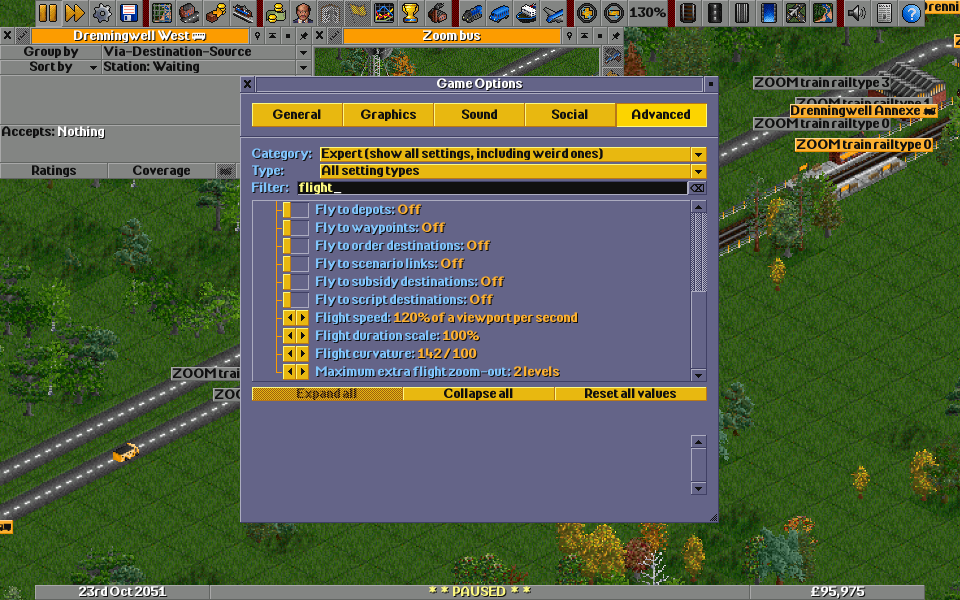
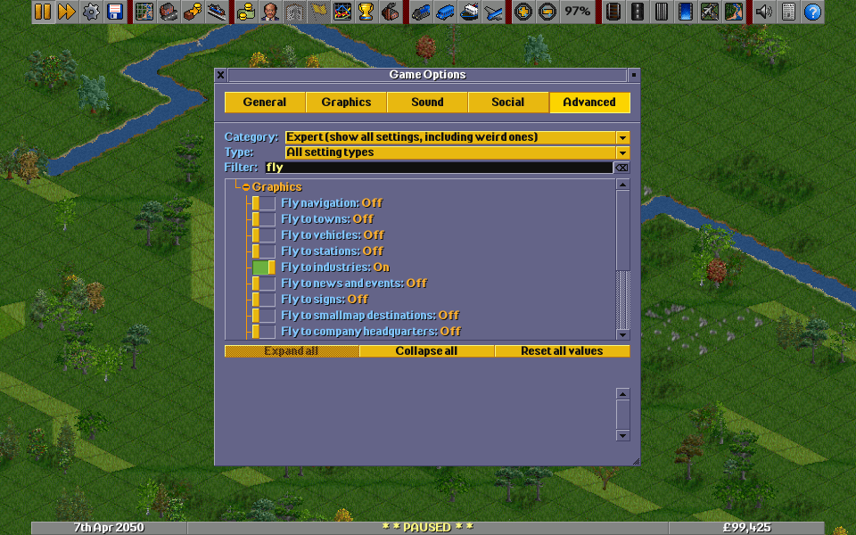
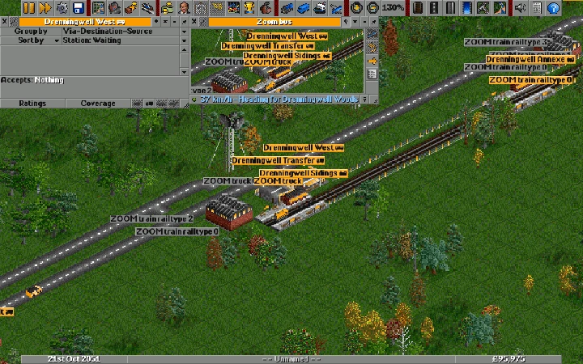

# Smooth zoom prototype: setup and use

See the [implementation and validation checklist](smooth_zoom_todo.md) for
what is complete and what still needs work.

This experimental build adds smaller mouse-wheel zoom steps. Smooth zoom is
disabled by default and requires a supported 32bpp blitter. Fractional rendering
can be slower than ordinary integer zoom. The prepared executable was rebuilt
on 10 October 2026 with animated wheel transitions, the toolbar snap control,
and opt-in fly-to navigation.
Restart an older running prototype to use these changes.

## Launch the prepared Windows prototype

On this development machine, the executable is `C:\ottd-build\Release\openttd.exe`.
The prepared launcher stages the matching language and base-set files and uses
an isolated test configuration. Run this in PowerShell:

```powershell
powershell.exe -NoProfile -ExecutionPolicy Bypass -File C:\Users\chris\github\OpenTTD\build-smoothzoom\desktop.ps1 -Action Start -Blitter 32bpp-sse4-anim -VideoDriver win32
```

Keep the terminal open while playing. The launcher starts a generated test map
with sound and music disabled. These paths and the ignored `build-smoothzoom`
launcher are specific to this prepared development machine; this is not a
standalone installation package.

## Existing saves, rollback and mod compatibility

This is an OpenTTD engine patch, not a NewGRF or a downloadable content pack.
Use the patched executable and its matching language files; enabling a NewGRF
in an ordinary OpenTTD installation cannot add these camera controls.

### Retrofit an existing game

An existing save or scenario can use smooth zoom and fly navigation immediately
if the underlying OpenTTD version can already load that file. No new game,
map conversion, rebuilding of infrastructure or NewGRF-list change is required.
Load the game normally and enable the local options in Advanced settings. With
the prepared development launcher, add `-Savegame "C:\path\to\your-game.sav"`
to the launch command above instead of generating a test map.

Keep the save's existing NewGRF files, versions, order and parameters. This
patch does not relax ordinary content dependencies or NewGRF incompatibilities.
Changing a running game's NewGRF list is a separate operation and is unnecessary
for this feature; see the [official NewGRF guide](https://wiki.openttd.org/en/Manual/NewGRF).

Camera options are local configuration settings (`NotInSave`, `NoNetworkSync`),
not game-world settings. A save sent to another player does not enable the
feature for them. Flight progress and fractional zoom are transient: saving
stores the current camera position with a traditional zoom level and adjusts
the origin to preserve the viewed centre. Loading restores that integer level
and cancels any pending flight. The exact fractional percentage, destination
and remaining flight time are not preserved.

The patch adds no savegame fields, chunks or savegame-version bump. A game saved
here should therefore remain readable by an **unmodified build that understands
the same upstream savegame version**, provided its content dependencies are
available. This is a source-level compatibility expectation, not a tested stock
save/load round trip. An older OpenTTD release, a newer-format save, or a save
from a patch pack with its own format extensions may still be incompatible.
To retain the option of returning to an older installation, keep the original
save and save prototype sessions under a different filename. Turning the camera
options off requires no game-data cleanup or uninstall operation inside the save.

### Content and renderer compatibility

The expectations below come from the code boundaries; only the stated coverage
has been exercised. No specific third-party NewGRF set is certified yet.

| Content or environment | Retrofit implications and current limits |
| --- | --- |
| OpenGFX / ordinary base graphics | OpenGFX 8.0 is the tested base set. Other supported base sets should use the same sprite pipeline, but have not been checked visually. |
| 8-bit NewGRF artwork | Expected to work through a supported 32bpp blitter, including palette remapping. **8-bit artwork is not the same as an 8bpp renderer**; switching the blitter does not require replacing those NewGRFs. |
| 32-bit / extra-zoom NewGRFs | Expected to load normally, without format or asset conversion. Different artwork at native sprite zoom levels can visibly change during a transition. Large sprites and high-resolution packs can increase redraw cost. These sets still need visual tests. |
| Vehicle, industry/cargo, house, object, station, track, road/tram and bridge NewGRFs | No deliberate content restriction or changes to their simulation rules. Custom sprite bounds, transparency, company colours, animation, articulated vehicles and trams remain important coverage gaps. Base infrastructure and representative base vehicles have been exercised; that does not validate every custom set. |
| Palette animation / translucency | Implemented in the supported rendering paths with remapping, alpha and dirty-region tests. Complex animated NewGRF scenes still need runtime validation. |
| AIs and Game Scripts | No AI/API format change is required. Script-triggered camera movement can animate when its flight option is enabled, changing presentation timing. Disable flights to preserve ordinary navigation behaviour. Local script navigation has a separate switch; multiplayer script redirects remain unvalidated and currently use the combined town/map switch. |
| Scenarios and heightmaps | Ordinary load/version/content requirements apply. A loaded scenario can use the camera options; an imported heightmap creates a world through the ordinary generator. |
| Sound/music packs | No audio format or playback changes are introduced by this patch. |
| Supported software 32bpp blitters | Fractional rendering is implemented in simple, optimized, SSE and animation families. Most runtime checks used `32bpp-anim` with the Windows `win32` video driver; other variants have differing runtime coverage. |
| 8bpp or null/headless blitters | Smooth zoom and animated flights are unavailable; normal navigation remains. A dedicated server does not need to render the effect. |
| OpenGL / `40bpp-anim` | Rendering support exists in the code, but full runtime and visual validation remains open. Do not infer support quality from the software-driver recordings. |
| Multiplayer | Camera preferences are per client, but normal executable-revision and NewGRF compatibility checks still apply. This private build has a different revision from stock OpenTTD and ordinarily cannot join a stock server. Use matching builds and content for server/clients; multiplayer testing is still open. See the [official multiplayer guide](https://wiki.openttd.org/en/Manual/Multiplayer). |
| Other engine patches / patch packs | Not a plug-in for another executable. Port the source changes and rebuild. Changes to viewports, blitters, zoom, toolbar/window input or settings may conflict; patches with custom save formats add separate compatibility constraints. No patch-pack integration has been validated. |

### Current evidence and remaining checks

Existing saved validation worlds have been loaded repeatedly, including loading
during a flight. Infrastructure, representative moving vehicles and camera
cancellation have been checked. Save-format declarations and the savegame
version remain unchanged; the only save/load adaptation converts the camera
view to the existing integer representation. The latest full Release suite
passes 13,627 assertions across 130 cases. Source references:
[camera save/load](../src/saveload/misc_sl.cpp),
[local settings](../src/table/settings/gui_settings.ini), and
[network revision checks](../src/network/core/network_game_info.cpp).

Still required: a stock-created save loaded here and saved back into a matching
stock build, representative NewGRF packs (including extra zoom and trams),
multiplayer with matching builds, multiplayer script redirects, and integration
with any intended patch pack. Keep these separate from the validated base-game
coverage in the [TODO list](smooth_zoom_todo.md).

## Enable smooth mouse-wheel zoom

Open **Game Options > Advanced** (the settings page), rather than the Graphics tab.
Select **Expert / all settings** in the settings filter, search for **smooth**,
and enable **Smooth mouse-wheel zoom**.

Alternatively, open the console using the key below Escape and enter:

```text
set gui.smooth_zoom 1
```

Close the console and scroll the mouse wheel over the map. Four wheel steps
double or halve the magnification. The updated controller eases into the target
and keeps its motion when further notches arrive. Zoom buttons continue to
select integer levels.

Wheel motion uses a faster pixel-centre sampler. Higher-quality area filtering
returns during the final visible movement, before the map comes to rest. The
nearly invisible easing tail ends once residual scale displacement is at most
one pixel across the viewport. Texture detail may
change slightly during zooming; it should not sharpen again after a pause at rest.

Following a moving vehicle uses the same fast sampler, including in its separate
vehicle window. Full-quality filtering returns when it stops or the simulation
pauses. Native zoom levels continue to use the original integer renderer.

The updated main toolbar displays a compact percentage button, such as **84%**.
Its tooltip shows the nearest traditional level. Click it to stop the transition
and snap to that traditional level. The button is hidden if the toolbar is too
narrow to accommodate it. An older prototype build will still jump directly
between wheel targets.

This close-up shows the percentage changing during a small zoom-out, followed
by a click on the percentage to snap back to **100%**. The existing plus and
minus buttons continue to select traditional levels.


For a specific fractional magnification, enter:

```text
smoothzoom 1.3
```

To return the current viewport to integer zoom, use `smoothzoom 0`. To disable
smooth wheel controls, use `set gui.smooth_zoom 0`.

## Fly to a location

Flight navigation is a separate, opt-in feature. In **Game Options > Advanced**,
select **Expert / all settings**, search for **fly**, and enable **Fly navigation**.
Then enable the destination categories you want. **Fly to towns and other map destinations** defaults to
on beneath the disabled master switch; all additional categories default to off.
Alternatively, enter `set gui.fly_navigation 1` in the console. It requires a
supported 32bpp blitter; the mouse-wheel smooth-zoom setting is independent.

Click a town in the town directory, or use a town window's location button.
The camera pans and zooms simultaneously along a continuous arc: it pulls back
while approaching the town, then moves in while continuing to approach.
Trips shorter than one starting viewport width avoid any extra pull-back.
Medium trips use the [van Wijk-Nuij zoom/pan model](https://vanwijk.win.tue.nl/zoompan.pdf),
which derives height and duration from the perceptual path. Animated journeys
last 300-2,200 ms; if the unbounded duration exceeds 2,500 ms, the camera jumps
directly. Disabling the existing smooth-scrolling setting also disables flights.
Ordinary destinations retain the player's exact zoom, including fractional
levels; they are not forced to a native level on landing. By default the town arrival
uses a traditional zoom level chosen from the town's estimated size. Automatic
fitting is approximate; choose a fixed **Town arrival zoom** if you prefer a
consistent view. Your configured zoom-in and zoom-out limits always apply.

The following options tune the experience. Search for **flight** to find the
timing controls. Search for **arrival** to find the town zoom selector, or clear
the filter and expand **Graphics** to see all of these options together.

| Option | Default | Effect |
| --- | --- | --- |
| Fly navigation | Off | Master switch for all navigation flights. |
| Fly to towns and other map destinations | On, subject to master switch | Enables town-directory, town-location and uncategorised map-location flights, including console `scrollto`. Console setting: `gui.fly_towns`. |
| Flight speed | 120% | Perceptual path speed (1.2 by default); range 25-400%. Duration grows with path length rather than map distance. |
| Flight duration scale | 100% | Scale the whole journey; range 25-200%. |
| Flight curvature | 142 / 100 | Lower values give flatter flights, higher values pull back more; range 25-300 / 100. |
| Maximum extra flight zoom-out | 2 levels | Longer trips reveal more of the route, up to this allowance; range 0–3. Zero removes the extra pull-back. |
| Town arrival zoom | Fit town automatically | Choose automatic fitting or a fixed level from 400% to 12.5%. |




Every additional category has its own switch. All require **Fly navigation**;
none requires **Fly to towns and other map destinations** or another category to be enabled.

This example enables the master switch and the combined town/map option,
with the other destination options off. Scroll to see the remaining categories.



| Switch | Navigation covered | Console setting |
| --- | --- | --- |
| Fly to vehicles | Vehicle window's location button | `gui.fly_vehicles` |
| Fly to stations | Station list and station location controls | `gui.fly_stations` |
| Fly to industries | Industry directory and industry location button | `gui.fly_industries` |
| Fly to news and events | News-item locations, including vehicle references | `gui.fly_news` |
| Fly to signs | Sign list and sign location controls | `gui.fly_signs` |
| Fly to smallmap destinations | Clicking a location on the smallmap | `gui.fly_smallmap` |
| Fly to company headquarters | Company's headquarters location control | `gui.fly_companies` |
| Fly to depots | Depot location controls | `gui.fly_depots` |
| Fly to waypoints | Waypoint location controls | `gui.fly_waypoints` |
| Fly to order destinations | Order-list and current-order destination controls | `gui.fly_orders` |
| Fly to scenario links | Story-page, goal and league-table location links | `gui.fly_scenarios` |
| Fly to subsidy destinations | Subsidy-list source/destination locations | `gui.fly_subsidies` |
| Fly to script destinations | Navigation requested by a game script | `gui.fly_scripts` |

For example, enable station flights without town or uncategorised map flights:

```text
set gui.fly_navigation 1
set gui.fly_towns 0
set gui.fly_stations 1
```

The switch follows the action used: a vehicle referenced in a news item uses
the news switch, while its own location button uses the vehicle switch. Order
destinations use the order switch even when the destination is a station.
**Fly to towns and other map destinations** combines town and uncategorised
map navigation; it does not override any other disabled category. The combined
switch retains `gui.fly_towns` and its existing value. The former
`gui.fly_other_navigation` setting is removed; use `gui.fly_towns` instead.

Turning off a category cancels any active flight in that category at its
currently displayed view. Turning off the master cancels every flight.
Vehicle location flights (including vehicle news references) blend toward the live vehicle position during the final
20% of the journey, without extending the flight. A removed vehicle cancels the
flight. Double-click following remains immediate and tracks it continuously.

Flight speed, duration scale, curvature and maximum pull-back apply to all enabled
flights; changed values take effect on the next journey. Start with 120% speed,
100% duration and curvature 142. Faster speed or a smaller duration scale gives
quicker travel. Curvature is reduced automatically to fit zoom limits, while pan
and zoom stay simultaneous. The old `gui.fly_zoom_duration` setting is replaced
by `gui.fly_duration_scale` (percent). `gui.fly_curve` is curvature multiplied by 100.

Begin a viewport drag, scroll the wheel or press any key to
interrupt a flight and take control at the currently displayed position and
zoom. A drag cancels on gesture start, before its first movement. The cancelled
flight does not resume or jump to its former destination. The percentage button also stops
the flight and snaps to a traditional level. Selecting another destination
starts a new journey from the displayed view. For other destinations, changing
the target mid-flight retains the intended arrival zoom rather than the
temporarily widened travel view. Ctrl-clicking a town still opens an extra
viewport, and explicit instant jumps and vehicle following stay immediate.
Disabling the master or the active flight's category, or changing the viewport
zoom limits, stops that flight at the current view, subject to those limits.

To try other destinations from the console:

```text
set gui.fly_navigation 1
set gui.fly_towns 1
scrollto 50 50
```

Leave the console open while that flight runs: closing it is a key press and
therefore interrupts the flight. `scrollto instant 50 50` bypasses the flight. Disable the feature with
`set gui.fly_navigation 0`. Flights are local display effects and do not change
the savegame format; loading cancels a pending journey.

This recording from 10 October 2026 shows selecting a town in the directory,
zooming and panning together across the map and arriving at 100%. The simulation is
paused; flight motion still runs. The looping WebP uses actual captured frames
and timing, and is a demonstration rather than a performance benchmark.


These recordings compare the same route with the perceptual flight model.
The fast configuration uses 200% speed and 100% duration scale; the gentler
configuration uses 120% speed and 100% duration scale. Curvature is 142 in both.
The default journey completed in about 1.47 seconds and the faster one in about
0.89 seconds in this paused fixture. The motions overlap throughout, with still
frames at either end of each clip. The recorded static land crop had no changes
after arrival; this is representative evidence, not exhaustive artefact coverage.


The following example selects Barringhill with a fixed 50% arrival zoom,
using the fast configuration.


## Zoom examples

### Moving vehicles

These recordings use a separate 2050 validation world containing a bus, truck,
four base rail technologies, ship, aircraft and helicopter. They demonstrate
moving sprites during fractional zoom; they do not establish exhaustive vehicle
or NewGRF coverage. Vehicle movies use WebP compression, so use raw game
screenshots when assessing individual pixel artefacts.





### Infrastructure examples

These recordings from 10 October 2026 use a saved validation world containing
no vehicles. Each starts at 130%, zooms out eight quarter-octave wheel notches
to 32.5%, and returns to 130%. They show the existing fractional renderer
handling additional base-game infrastructure; they do not establish coverage
of every NewGRF or moving sprite.


A later-year fixture extends these checks to the four base rail technologies,
road bridges, a lock and additional tunnel portals:


The final static example includes deliberately raised terrain, road and rail
foundations, and a steep hill. The base-game fixture has no available tram
road type, so tram coverage needs a suitable tram NewGRF.


### Wheel and toolbar examples

These looping recordings show the prototype from 9 October 2026. The game is
paused to make the zoom movement easier to see. They use actual captured frames,
at approximately 20 frames per second, with the captured timing preserved;
they illustrate the controls rather than measure rendering performance. Each
example returns to its starting magnification. Open the animated WebP images
in a browser if your document viewer only displays a still frame.

**Small change:** one wheel notch zooms from 100% to about 84%, then one notch
returns to 100%.


**Fast input:** four rapidly spaced wheel notches zoom from 100% to 200%, then
four reverse notches return to 100%. Further input keeps the motion going.


**Slow input:** four wheel notches spaced roughly 300 ms apart zoom from 100%
to 50%, then reverse. This shows smaller individual changes.


**Large change:** eight rapid notches zoom from 100% to 25%, then eight reverse
notches return to 100%, crossing several traditional levels.


## Try the prototype

Inspect coastlines, slopes, roads and buildings while zooming and scrolling.
Look for tile seams, flickering, misplaced labels and sluggish rendering. Include
the zoom level and a screenshot when reporting a problem. Saving records a
nearby integer zoom level; loading resets the viewport to integer zoom.

See [the controls documentation](smooth_zoom_controls.md) for more behavior details.
