# Smooth zoom prototype: setup and use

See the [implementation and validation checklist](smooth_zoom_todo.md) for
what is complete and what still needs work.

This experimental build adds smaller mouse-wheel zoom steps. Smooth zoom is
disabled by default and requires a supported 32bpp blitter. Fractional rendering
can be slower than ordinary integer zoom. The prepared executable was rebuilt
on 10 October 2026 with animated wheel transitions, the toolbar snap control,
and opt-in fly-to navigation.
Restart an older running prototype to use these changes.

## Launch the prepared Windows prototype

On this development machine, the executable is `C:\ottd-build\Release\openttd.exe`.
The prepared launcher stages the matching language and base-set files and uses
an isolated test configuration. Run this in PowerShell:

```powershell
powershell.exe -NoProfile -ExecutionPolicy Bypass -File C:\Users\chris\github\OpenTTD\build-smoothzoom\desktop.ps1 -Action Start -Blitter 32bpp-sse4-anim -VideoDriver win32
```

Keep the terminal open while playing. The launcher starts a generated test map
with sound and music disabled. These paths and the ignored `build-smoothzoom`
launcher are specific to this prepared development machine; this is not a
standalone installation package.

## Enable smooth mouse-wheel zoom

Open **Game Options → Advanced** (the settings page), rather than the Graphics tab.
Select **Expert / all settings** in the settings filter, search for **smooth**,
and enable **Smooth mouse-wheel zoom**.

Alternatively, open the console using the key below Escape and enter:

```text
set gui.smooth_zoom 1
```

Close the console and scroll the mouse wheel over the map. Four wheel steps
double or halve the magnification. The updated controller eases into the target
and keeps its motion when further notches arrive. Zoom buttons continue to
select integer levels.

Wheel motion uses a faster pixel-centre sampler. Higher-quality area filtering
returns during the final visible movement, before the map comes to rest. The
nearly invisible easing tail ends once residual scale displacement is at most
one pixel across the viewport. Texture detail may
change slightly during zooming; it should not sharpen again after a pause at rest.

Following a moving vehicle uses the same fast sampler, including in its separate
vehicle window. Full-quality filtering returns when it stops or the simulation
pauses. Native zoom levels continue to use the original integer renderer.

The updated main toolbar displays a compact percentage button, such as **84%**.
Its tooltip shows the nearest traditional level. Click it to stop the transition
and snap to that traditional level. The button is hidden if the toolbar is too
narrow to accommodate it. An older prototype build will still jump directly
between wheel targets.

This close-up shows the percentage changing during a small zoom-out, followed
by a click on the percentage to snap back to **100%**. The existing plus and
minus buttons continue to select traditional levels.

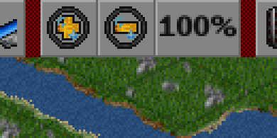

For a specific fractional magnification, enter:

```text
smoothzoom 1.3
```

To return the current viewport to integer zoom, use `smoothzoom 0`. To disable
smooth wheel controls, use `set gui.smooth_zoom 0`.

## Fly to a location

Flight navigation is a separate, opt-in feature. In **Game Options → Advanced**,
select **Expert / all settings**, search for **fly**, and enable **Fly to towns**.
Alternatively, enter `set gui.fly_navigation 1` in the console. It requires a
supported 32bpp blitter; the mouse-wheel smooth-zoom setting is independent.

Click a town in the town directory, or use a town window's location button.
The camera pans and zooms simultaneously along a continuous arc: it pulls back
while approaching the town, then moves in while continuing to approach.
Nearby trips avoid an unnecessary pull-back. By default the arrival
uses a traditional zoom level chosen from the town's estimated size. Automatic
fitting is approximate; choose a fixed **Town arrival zoom** if you prefer a
consistent view. Your configured zoom-in and zoom-out limits always apply.

The following options tune the experience. Search for **flight** to find the
timing controls. Search for **arrival** to find the town zoom selector, or clear
the filter and expand **Graphics** to see all of these options together.

| Option | Default | Effect |
| --- | --- | --- |
| Fly to towns | Off | Enables town-directory and town-location flights. |
| Fly to other map destinations | Off | Also animates the smallmap and other location buttons; these trips retain the current zoom at arrival. Requires Fly to towns. |
| Flight pan speed | 100% of a viewport per second | Higher values shorten the journey; range 25–400%. Very short and long journeys have bounded durations. |
| Flight zoom timing | 350 ms at each end | Higher values give gentler departure and arrival; range 100–2,000 ms. |
| Maximum extra flight zoom-out | 2 levels | Longer trips reveal more of the route, up to this allowance; range 0–3. Zero removes the extra pull-back. |
| Town arrival zoom | Fit town automatically | Choose automatic fitting or a fixed level from 400% to 12.5%. |

Pan speed, zoom timing and the maximum pull-back apply to all enabled flights;
changed values take effect on the next journey. For a quicker experience, try
200% pan speed and 200 ms zoom timing. For gentler travel, try 75% and 500 ms.

Begin a viewport drag, use the arrow keys, scroll the wheel or press Escape to
interrupt a flight and take control at the currently displayed position and
zoom. A drag cancels on gesture start, before its first movement. The cancelled
flight does not resume or jump to its former destination. The percentage button also stops
the flight and snaps to a traditional level. Selecting another destination
starts a new journey from the displayed view. For other destinations, changing
the target mid-flight retains the intended arrival zoom rather than the
temporarily widened travel view. Ctrl-clicking a town still opens an extra
viewport, and explicit instant jumps and vehicle following stay immediate.
Disabling Fly to towns or changing the viewport zoom limits stops an active
flight at the current view, subject to those limits.

To try other destinations from the console:

```text
set gui.fly_navigation 1
set gui.fly_other_navigation 1
scrollto 50 50
```

`scrollto instant 50 50` bypasses the flight. Disable the feature with
`set gui.fly_navigation 0`. Flights are local display effects and do not change
the savegame format; loading cancels a pending journey.

This recording from 10 October 2026 shows selecting a town in the directory,
zooming and panning together across the map and arriving at 100%. The simulation is
paused; flight motion still runs. The looping WebP uses actual captured frames
and timing, and is a demonstration rather than a performance benchmark.

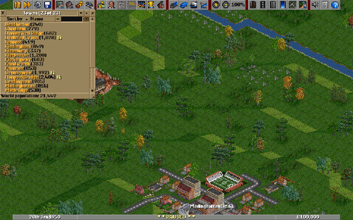

These additional recordings compare configurable navigation on 10 October 2026.
The first two take the same route from tile (180, 180) to Bendhattan, arriving
at 100%. The fast configuration uses 200% pan speed and 200 ms zoom timing;
the gentle configuration uses 75% and 500 ms. Their measured journeys took
different lengths, excluding the still frames at either end. Pan speed and zoom
timing contribute to the total duration; the motions overlap throughout.


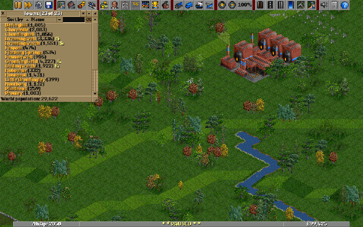

The following example selects Hanpool Bridge with a fixed 50% arrival zoom,
using the fast configuration.


## Zoom examples

### Moving vehicles

These recordings use a separate 2050 validation world containing a bus, truck,
four base rail technologies, ship, aircraft and helicopter. They demonstrate
moving sprites during fractional zoom; they do not establish exhaustive vehicle
or NewGRF coverage. Vehicle movies use WebP compression, so use raw game
screenshots when assessing individual pixel artefacts.

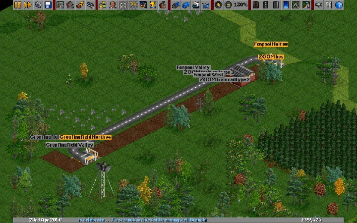

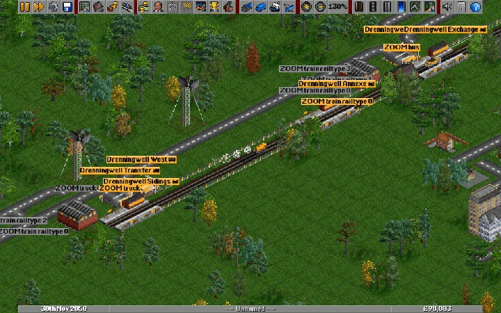

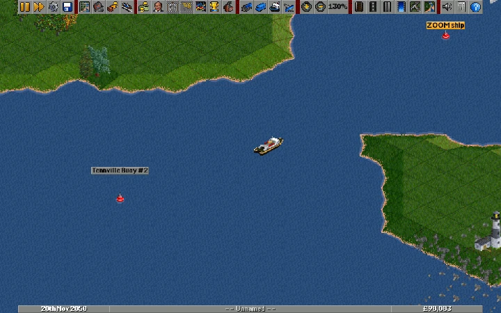

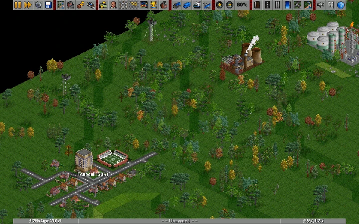

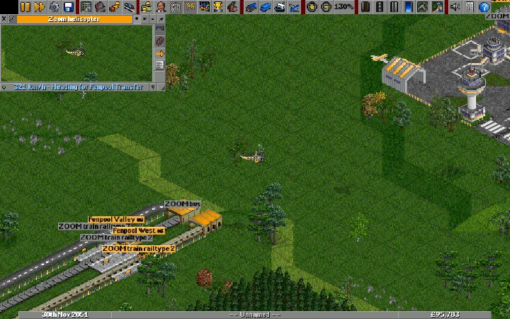

### Infrastructure examples

These recordings from 10 October 2026 use a saved validation world containing
no vehicles. Each starts at 130%, zooms out eight quarter-octave wheel notches
to 32.5%, and returns to 130%. They show the existing fractional renderer
handling additional base-game infrastructure; they do not establish coverage
of every NewGRF or moving sprite.

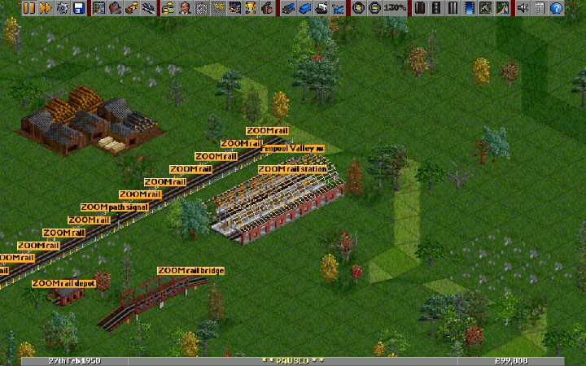

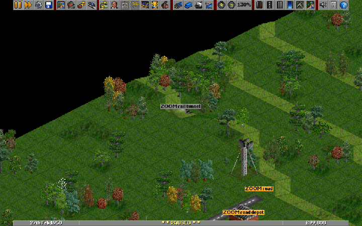

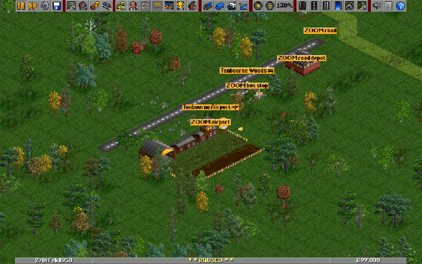

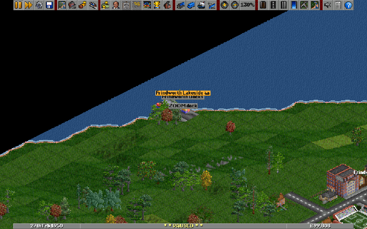

A later-year fixture extends these checks to the four base rail technologies,
road bridges, a lock and additional tunnel portals:

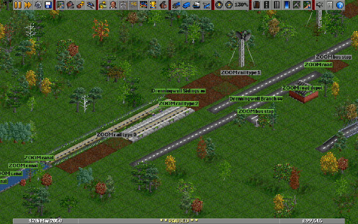

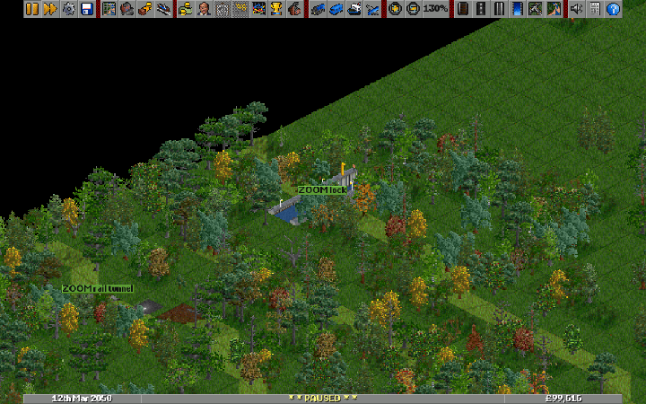

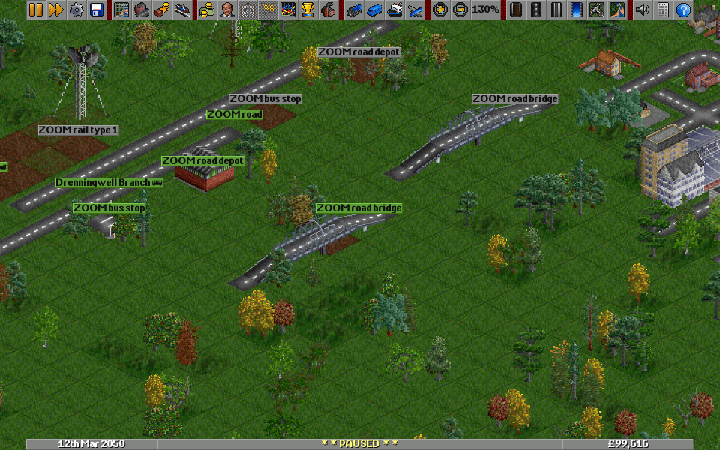

The final static example includes deliberately raised terrain, road and rail
foundations, and a steep hill. The base-game fixture has no available tram
road type, so tram coverage needs a suitable tram NewGRF.

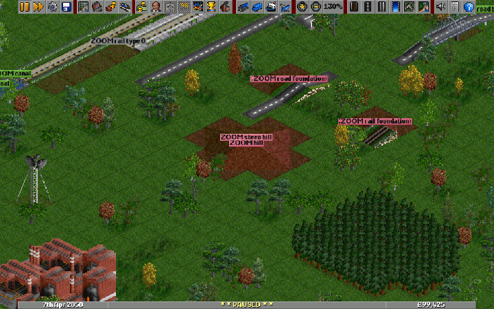

### Wheel and toolbar examples

These looping recordings show the prototype from 9 October 2026. The game is
paused to make the zoom movement easier to see. They use actual captured frames,
at approximately 20 frames per second, with the captured timing preserved;
they illustrate the controls rather than measure rendering performance. Each
example returns to its starting magnification. Open the animated WebP images
in a browser if your document viewer only displays a still frame.

**Small change:** one wheel notch zooms from 100% to about 84%, then one notch
returns to 100%.

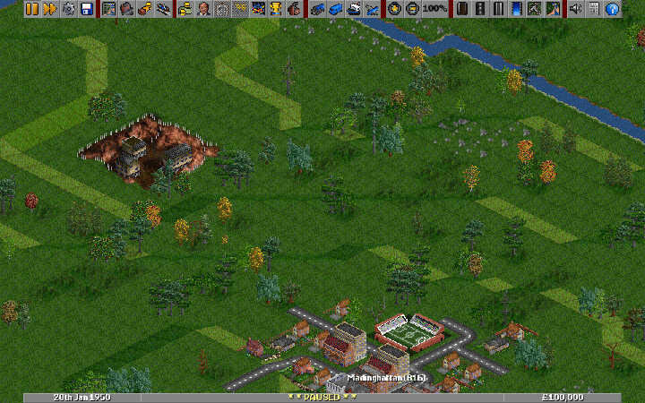

**Fast input:** four rapidly spaced wheel notches zoom from 100% to 200%, then
four reverse notches return to 100%. Further input keeps the motion going.


**Slow input:** four wheel notches spaced roughly 300 ms apart zoom from 100%
to 50%, then reverse. This shows smaller individual changes.


**Large change:** eight rapid notches zoom from 100% to 25%, then eight reverse
notches return to 100%, crossing several traditional levels.


## Try the prototype

Inspect coastlines, slopes, roads and buildings while zooming and scrolling.
Look for tile seams, flickering, misplaced labels and sluggish rendering. Include
the zoom level and a screenshot when reporting a problem. Saving records a
nearby integer zoom level; loading resets the viewport to integer zoom.

See [the controls documentation](smooth_zoom_controls.md) for more behavior details.
