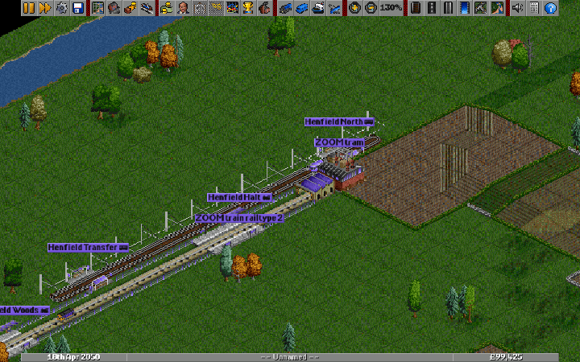
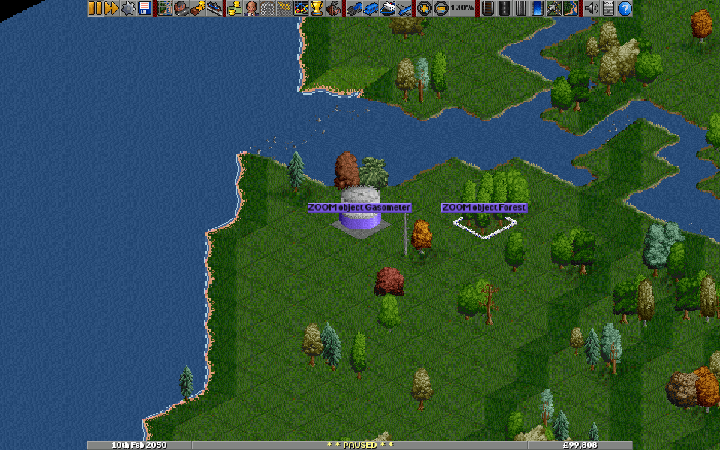

# Graphics and renderer coverage

This records representative runtime checks, rather than a guarantee for every
NewGRF, font, driver or graphics card. Results dated 10 October 2026.

## OpenGFX 8.0

All eleven configurations passed with the paused `zoom-navigation.sav` fixture:

| Configuration | Checks |
| --- | --- |
| 32bpp-anim, simple, optimized, SSE2 and SSE4 | 100%, 130%, 200%, 84%, 25%; stable fractional rest; save/load |
| 40bpp-anim with Windows OpenGL | Same zoom, settling and save/load checks |
| 8bpp-optimized | Native rendering and unsupported fractional request remain safe |
| 1920 × 1080 | Same zoom, settling and save/load checks |
| 200% interface scale at 1600 × 1000 | Same zoom, settling and save/load checks |
| Arabic and Japanese interfaces at 1280 × 800 | Same zoom, settling and save/load checks |

Software and OpenGL native-200% label crops matched pixel for pixel. The
OpenGL check exposed a background-composition issue: palette indices can live
separately from RGB pixels. Scaled labels now resolve those colours through the
blitter before blending their text edges.

The release unit suite passes 68,807 assertions in 140 cases after this fix,
including GPU-format decoding, palette/partial-alpha sprites and clipped-source
checks. Native SSE palette and alpha arithmetic can differ from the scalar
compositor by one RGB unit; opaque non-palette comparisons remain byte-exact.
The runtime checks are functional checks, not comparative frame-rate benchmarks.

## Additional graphics sets

OpenGFX2 Classic 0.8 and OpenGFX2 High Def 0.8 each passed all eleven
configurations in the table above. Classic supplies palette artwork; High Def
supplies 32-bit extra-zoom artwork. Native and fractional rendering therefore
exercise different source formats with the same camera and label code.
Downloads come from the
[official OpenGFX2 0.8 release](https://github.com/OpenTTD/OpenGFX2/releases/tag/0.8).
Downloaded graphics remain local and are not bundled with this modification.

The [machine-readable results](zoom-matrix-results.json) record the 33 passing
configurations, individual checks, local artifact paths and archive SHA-256
hashes. Early High Def attempts sent input before sprite loading completed;
the harness now waits longer at startup and after loading a save. Two interrupted
or incomplete runs were repeated successfully. Original Transport Tycoon
graphics and zBase have not been tested in this pass.

## Repeating the matrix

Stage the prototype assets with `launch-prototype.ps1`, install Pillow into
`build-smoothzoom/capture-deps`, and run:

```powershell
py -3 docs/validation/run-zoom-matrix.py --case all --graphics OpenGFX
py -3 docs/validation/run-zoom-matrix.py --case all --graphics "OpenGFX2 High Def"
```

Each run owns its game process and stores screenshots, console logs and JSON
results under `build-smoothzoom/coverage`. Graphics archives must already be in
`build-smoothzoom/baseset`. High-definition graphics need a longer startup wait.

## NewGRF and text fixture

`ZoomCoverage` extends the vehicle fixture with tram stops, waypoints, custom
company colours and Arabic, Japanese and accented Latin signs. Install its
folder as a local AI together with the official OpenGFX2 tram, tree, station and
object GRFs. Its Unicode source uses a UTF-8 BOM, required by the Squirrel loader.

Arabic and accented Latin signs were checked with Segoe UI; Japanese signs
were checked with Yu Gothic at 130%. A font without the
requested characters displays missing-glyph boxes; scaling cannot supply absent
glyphs. In the unpaused fixture, tram 10 changed tile from 3257 to 3254 at speed
40; the truck and four trains also reported changing positions and nonzero
speeds in the AI debug window. The clip below exercises their infrastructure,
company colours, wires and trees while zooming. Changing vehicle and animated
world pixels are expected; this is not a paused-scene settling comparison.
Interface-language checks above are separate from these custom-sign checks.



The extended fixture also builds eight objects, including a gasometer,
substations, a transmitter, a lighthouse and forests. The objects and their
shadows were checked at fractional zoom, including the game's transparency
toggle. The fixture's construction log identifies their locations for repeatable
camera checks.


## Pan performance

A capture-free nine-second right-drag check on the paused OpenGFX fixture,
using `32bpp-anim` and `win32:no_threads`, measured:

| Window | Native 100% | Fractional 130% before | Fractional 130% after |
| --- | --- | --- | --- |
| 960 × 600 | about 60 FPS | about 47 FPS | about 60 FPS |
| 1920 × 1080 | about 60 FPS | about 16 FPS | about 58 FPS |

These are this machine's measurements, not a hardware-independent promise.
Fractional pan now retains a pixel-aligned rendering origin at a fixed scale,
allowing it to copy pixels and redraw exposed strips. The displayed origin stays
within half a screen pixel of the requested position. Picking and dirty bounds
use that same origin, and animated palette dependencies move with copied pixels.
Changing the scale still redraws the viewport.

Both the original and final measurements ran without screenshot capture or
another active matrix. A palette-resolution experiment did not establish a useful
speed improvement and was removed. The final 512-sample viewport drawing means
were about 2.4 ms at 960 × 600 and 4.1 ms at 1920 × 1080 during the pan check.

All eleven OpenGFX configurations pass the updated matrix. Supported renderers
add 130%, 84% and 66⅔% pan checks, proving that the scene moves and that the
paused land/label crop matches a forced full redraw. The additional checks also
pass with High Def software/OpenGL and Classic at 1080p. These checks validate
the copied pixels rather than relying only on apparent steadiness.



In this paused object/coast fixture, the recorded land crop last changed at
2,222 ms, before the right-button release at 2,400 ms, and stayed unchanged
through the final capture at 6,523 ms. Palette animation and moving world content
remain separate from camera settling.

## Existing saves

A stock build of upstream revision `fab8089e6bed2be570b6b0a2cb9f19a5db16a7da`
created a new save. The modified build loaded it, selected 130% zoom and saved
it; the stock build then reopened that save successfully. Screenshots and console
logs are under `build-smoothzoom/stock-profile`. The test can be repeated with:

```powershell
py -3 docs/validation/run-save-roundtrip.py --stock <path-to-stock-openttd.exe>
```

The fractional view is client state; the save retains an integer zoom value.
This test used OpenGFX without NewGRFs. A save that uses NewGRFs still needs
those NewGRFs available when loaded, as in stock OpenTTD.
